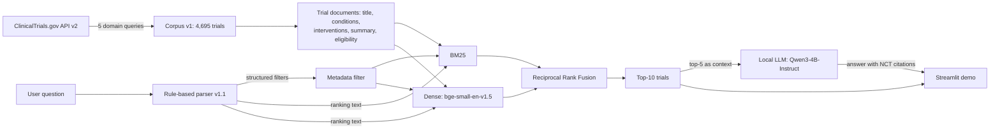

# Clinical Research Intelligence Assistant

A retrieval-augmented search assistant for clinical trials. A researcher asks a
question in plain English ("Recruiting NSCLC trials involving pembrolizumab");
the system extracts structured filters, retrieves matching trials from a
ClinicalTrials.gov snapshot with hybrid lexical + dense search, and writes a
short answer that cites NCT IDs, using only the retrieved trials.

**Status:** working baseline (research prototype). Retrieval quality was
measured on a hand-labeled evaluation set; the numbers below are what was
measured, including where the system fails.

## Problem

Trial registries are searched mostly by keyword. Natural-language questions
mix **concepts** (disease, drug) with **hard constraints** (recruiting, phase,
age, sex, study type). Similarity search alone treats the constraints as soft:
a breast-cancer trial can outrank an NSCLC trial for an NSCLC question, and a
"not yet recruiting" request can return recruiting trials. This project builds
a small but measurable pipeline that separates the two, and an evaluation set
that shows where it works and where it does not.

## Architecture



## Quick start (demo)

Requirements: the `clinical_rag_clean` conda environment
(`environment-lock.yml`, `requirements-lock.txt`) and one GPU with ~10 GB free.

```bash
conda activate clinical_rag_clean
cd clinical-research-intelligence
streamlit run app/frontend/streamlit_app.py
```

Open the URL Streamlit prints (default http://localhost:8501). The first query
builds the embedding cache (`data/indexes/`, ~15 s) and loads the LLM
(`Qwen/Qwen3-4B-Instruct-2507`, from the Hugging Face cache); later queries
take well under a second for retrieval and a few seconds for the answer.
The demo shows: the parsed filters, the text used for ranking, the top-10
trials as cards with ClinicalTrials.gov links, and the generated answer.

## Data — corpus v1

- **4,695 unique trials** from the ClinicalTrials.gov API v2 (data version
  2026-10-07): the first 1,000 results of the API's default order for five
  `query.cond` terms — cancer, neurological, cardiovascular, infectious
  disease, diabetes. 5,000 records fetched, 305 duplicates removed.
- Frozen and versioned: `data/corpus_v1_manifest.json` records SHA-256 hashes,
  fetch parameters and statistics; a read-only backup of the raw JSON exists
  outside the repository.
- **Limitation:** this is not a random sample. It is the first 1,000 results
  per domain query, so results cannot be generalized to ClinicalTrials.gov as
  a whole, and some topics are thin (e.g. only 12 Alzheimer's trials, none
  recruiting).

## Retrieval

| Component | Implementation |
|---|---|
| Query parser | Rule-based (`src/query_understanding/parser_v1_1.py`): status (incl. "not yet recruiting", "currently enrolling"), phase (digits and Roman numerals), sex, adults, study type (incl. "non-interventional", "excluding observational"). The original parser is kept unchanged for reproducibility. |
| Metadata filter | Applied **before** ranking (`src/retrieval/metadata_filter.py`). |
| BM25 | `rank_bm25` Okapi BM25 over the whole corpus (corpus-wide IDF); only filter-eligible trials are ranked. |
| Dense | `BAAI/bge-small-en-v1.5`, normalized embeddings, exact inner product. |
| Hybrid | Reciprocal Rank Fusion of the top-100 BM25 and dense lists (k = 60). |
| Reranker | `BAAI/bge-reranker-base` cross-encoder (evaluated; off by default, see findings). |
| Generation | `Qwen/Qwen3-4B-Instruct-2507`, local, greedy decoding. Context = top-5 trials (title, conditions, interventions, status, phase). The prompt restricts the answer to these trials, requires `[NCT ID](https://clinicaltrials.gov/study/NCT ID)` citations, and requires an explicit "None of the retrieved trials match this query." when nothing fits. |

All three entry points (evaluation, RAG script, demo) use the same
`TrialSearchEngine` (`src/retrieval/pipeline.py`). With the original parser
it reproduces the saved experiment rankings exactly for 26/26 queries.

## Evaluation

- **26 queries** (`data/evaluation/query_specs_v1.1.json`) across all five
  domains: abbreviations, brand names, paraphrases, drug classes,
  multi-constraint queries, parser edge cases (Roman numerals, negation,
  pediatric, older adults) and **4 verified zero-answer queries**. Query text
  was committed before any corpus check.
- **Split:** 16 dev / 10 test. The test set has not been evaluated yet.
- **474 graded relevance judgments** (`data/evaluation/qrels_v1.2.csv`),
  labeled manually with a written rubric (`docs/labeling_rubric_v1.1.md`). The
  labeler judges only the core concepts (disease: exact / broader / absent;
  intervention: exact / class-level / absent); the 0/1/2 grade is derived in
  code, and structured constraints (status, phase, sex, age, study type) are
  checked automatically from metadata.
- **Pools:** union of 6 retrieval systems × 2 filter modes, depth 10 / 5, plus
  concept-matched candidates, within a 500-pair labeling budget.
- **Metrics** (`src/evaluation/retrieval_metrics.py`, unit-tested): graded
  nDCG@K (gain 2^g − 1), precision / recall / MRR at strict and lenient
  thresholds, Judged@K, nDCG on condensed lists (unjudged removed),
  constraint-violation rate, bootstrap CIs and paired sign-flip tests.

### Baseline results (dev, 15 answerable queries, qrels v1.2)

| System | nDCG@10 | nDCG@10 (unjudged removed) | P@10 (grade ≥ 1) | MRR (grade ≥ 1) | Judged@10 | Violation rate@10 |
|---|---:|---:|---:|---:|---:|---:|
| BM25 | 0.516 | 0.569 | 0.433 | 0.707 | 0.82 | 0.150 |
| Dense (bge-small) | 0.589 | 0.679 | 0.473 | 0.780 | 0.78 | 0.162 |
| RRF hybrid | 0.636 | 0.636 | 0.573 | 0.775 | 0.94 | 0.181 |
| RRF + cross-encoder | 0.516 | 0.622 | 0.407 | 0.749 | 0.73 | 0.131 |

With 15 queries the confidence intervals are wide (e.g. RRF nDCG@10 95% CI
0.437–0.816). Source: `data/evaluation/results/baseline_v1.2_dev/`.

### Parser fix (dev, RRF only, no other change)

| RRF on dev | nDCG@10 | Violation rate@10 |
|---|---:|---:|
| Original parser | 0.636 | 0.181 |
| Parser v1.1 | **0.737** | **0.031** |
| Ceiling with gold filters | 0.738 | 0.000 |

Three dev queries changed (Q20 0.00 → 1.00, Q23 0.40 → 0.86, Q22 0.52 →
0.57); none got worse. With only three changed queries the overall
difference is not statistically significant (paired p = 0.25).
Source: `data/evaluation/results/parser_fix_v1.1_dev/`.

### RAG answers (5 dev queries)

`data/evaluation/results/rag_v1_dev/rag_outputs.md`. No answer cited a trial
outside its context. The model correctly said that nothing matched on the
three queries whose top-5 contained no relevant trial (including the
zero-answer query). It made two errors: on Q01 it demoted a fully relevant
trial whose intervention field is empty and added an unsupported claim; on
Q20 it wrongly said no trial matched, although one did. Five examples are
illustrations, not an evaluation of answer quality.

## Key findings

1. **Unjudged documents can create fake differences.** Full-list nDCG@10 says
   the cross-encoder is worse than RRF (−0.120, p = 0.043). After removing
   unjudged trials the gap is −0.014 (p = 0.80): the reranker's top-10 was
   simply less covered by the judgment pool. Judged@K must be reported next to
   every metric.
2. **Parser errors cause the constraint violations.** All top-10 violations on
   dev came from queries the parser misread ("not yet recruiting" parsed as
   recruiting; "currently enrolling", "non-interventional" and "pediatric"
   ignored). Fixing the first three raised RRF nDCG@10 from 0.636 to 0.737,
   matching the gold-filter ceiling (0.738), and cut the violation rate from
   0.181 to 0.031; the remainder is the unhandled "pediatric" query.
3. **Brand names fail lexically.** For "Keytruda trials in lung cancer" (Q11)
   nDCG@10 is 0.00 for BM25 and RRF and 0.17 for dense retrieval; the drug
   appears in the corpus as "pembrolizumab", "KEYTRUDA®" or MK-3475.
4. **No retriever abstains.** For a verified zero-answer query (lecanemab,
   Q24) every system returns a full list, and the cross-encoder's top score
   (0.82) gives no signal that nothing matches. Only the LLM step said so.
5. **Hybrid fusion is the only reliable improvement measured:** RRF beats
   BM25 by +0.067 nDCG@10 on condensed lists (p = 0.008); RRF vs dense and
   RRF vs the reranker are not distinguishable on this dev set.

## Limitations and future work

- **Processor extension:** MeSH condition/intervention terms, intervention
  `otherNames` (brand names), official titles, arm descriptions and detailed
  descriptions exist in the raw data but are not yet indexed; some relevant
  evidence lives only there.
- **Synonym / concept normalization** (e.g. Keytruda → pembrolizumab,
  dementia ⊃ Alzheimer's disease) and concept-level verification of each result.
- **Parser:** pediatric/older-adult phrases, combined phases ("Phase 1/2") and
  the female/ALL sex rule are not handled yet; a fuller parser design and
  80-phrasing test set are in `docs/m2_task1_parser_design.md` and
  `tests/test_parser_v2.py`.
- **Abstention:** a calibrated "no matching trial" signal at retrieval time.
- **Reranker input:** rerank on the parsed query text instead of the raw
  question; judge the 72 unjudged dev top-10 trials before comparing rankers.
- **Answer quality:** the RAG prompt should only require what the question
  asks (the Q20 error); systematic faithfulness and citation evaluation.
- **Evaluation:** run the held-out test set once at the end of a milestone;
  inter-rater consistency check (a 46-pair re-label sample is prepared).
- **Engineering:** FastAPI backend, incremental freshness updates from the
  API (corpus v2 as a new version), latency and scaling.

## Repository layout

```
app/frontend/streamlit_app.py   demo
src/query_understanding/        parser.py (v1, frozen), parser_v1_1.py
src/retrieval/                  bm25, embeddings, metadata_filter, hybrid, pipeline
src/generation/                 context_builder.py, llm.py
src/evaluation/                 judgments.py, retrieval_metrics.py, label_import.py
experiments/                    numbered, reproducible experiment scripts (01–29)
data/evaluation/                query specs, qrels, labeling sheets, runs, results
docs/                           labeling rubric and guide, pooling plan, parser design
tests/                          unit tests (python -m unittest discover -s tests)
```

## Reproducing the results

```bash
conda activate clinical_rag_clean
python -m unittest discover -s tests                                   # 54 tests
PYTHONPATH=$PWD python experiments/27_baseline_dev_evaluation.py \
    --qrels data/evaluation/qrels_v1.2.csv --out-dir data/evaluation/results/<new_folder>
PYTHONPATH=$PWD python experiments/28_parser_fix_dev_eval.py           # parser fix (dev)
PYTHONPATH=$PWD python experiments/29_rag_dev_examples.py              # RAG examples
```

Result scripts refuse to overwrite existing outputs; rename or move the output
folder to re-run. Every step is a separate git commit.

*Research prototype for information retrieval; not a medical device and not
medical advice.*
