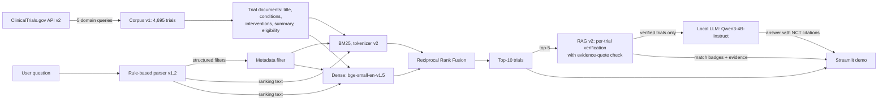

# Clinical Research Intelligence Assistant

A retrieval-augmented search assistant for clinical trials. A researcher asks a
question in plain English ("Recruiting NSCLC trials involving pembrolizumab");
the system extracts structured filters, retrieves matching trials from a
ClinicalTrials.gov snapshot with hybrid lexical + dense search, and writes a
short answer that cites NCT IDs, using only the retrieved trials.

**Status:** working baseline (research prototype). All design choices were
made on a development query set; frozen configurations were then evaluated
**once** on a held-out test set — retrieval once (tag `frozen-final`) and the
answer step once (tag `frozen-rag-v2`). Because the retrieval test set has
been used, failures seen there (Q12, Q17) were **not** fixed; they are listed
as future work. The numbers below are what was measured, including failures.

## Problem

Trial registries are searched mostly by keyword. Natural-language questions
mix **concepts** (disease, drug) with **hard constraints** (recruiting, phase,
age, sex, study type). Similarity search alone treats the constraints as soft:
a breast-cancer trial can outrank an NSCLC trial for an NSCLC question, and a
"not yet recruiting" request can return recruiting trials. This project builds
a small but measurable pipeline that separates the two, and an evaluation set
that shows where it works and where it does not.

## Architecture



## Quick start (demo)

Requirements: the `clinical_rag_clean` conda environment
(`environment-lock.yml`, `requirements-lock.txt`) and one GPU with ~10 GB free.

```bash
conda activate clinical_rag_clean
cd clinical-research-intelligence
streamlit run app/frontend/streamlit_app.py
```

Open the URL Streamlit prints (default http://localhost:8501). The first query
builds the embedding cache (`data/indexes/`, ~15 s) and loads the LLM
(`Qwen/Qwen3-4B-Instruct-2507`, from the Hugging Face cache); afterwards
retrieval takes tens of milliseconds and verification plus answer a few
seconds (median 8.5 s on dev, 6.9 s on test with RAG v2). The demo shows the
parsed filters, the text used for ranking, the top-10 trials as cards with
ClinicalTrials.gov links, a MATCH / PARTIAL / NO MATCH badge with the
verified evidence quote for each of the top-5, and the generated answer
(RAG v1 is available as an option). It uses the frozen configurations.

## Data — corpus v1

- **4,695 unique trials** from the ClinicalTrials.gov API v2 (data version
  2026-10-07): the first 1,000 results of the API's default order for five
  `query.cond` terms — cancer, neurological, cardiovascular, infectious
  disease, diabetes. 5,000 records fetched, 305 duplicates removed.
- Frozen and versioned: `data/corpus_v1_manifest.json` records SHA-256 hashes,
  fetch parameters and statistics; a read-only backup of the raw JSON exists
  outside the repository. `data/processed/trials_v2.parquet` adds official
  title, intervention other names, MeSH terms and keywords for the same trials.
- **Limitation:** this is not a random sample. It is the first 1,000 results
  per domain query, so results cannot be generalized to ClinicalTrials.gov as
  a whole, and some topics are thin (e.g. 12 Alzheimer's trials, none
  recruiting).

## Final pipeline (frozen in `src/config.py`)

| Component | Implementation |
|---|---|
| Query parser v1.2 | Rule-based (`src/query_understanding/parser_v1_2.py`): recruitment status incl. "not yet recruiting" / "currently enrolling", phase (digits and Roman numerals), sex, study type incl. "non-interventional" / "excluding observational", and age groups (pediatric, adolescents, infants, adults, older adults, "over N", "under N"). Earlier parser versions are kept unchanged. |
| Metadata filter | Applied **before** ranking (`src/retrieval/metadata_filter.py`); an age filter keeps trials whose eligible age range includes the requested group. |
| BM25 | `rank_bm25` Okapi BM25, corpus-wide IDF; **tokenizer v2** splits on punctuation and symbols ("KEYTRUDA®", "(NSCLC),") and drops a short list of generic filler words. |
| Dense | `BAAI/bge-small-en-v1.5`, normalized embeddings, exact inner product. |
| Hybrid | Reciprocal Rank Fusion of the top-100 BM25 and dense lists (k = 60). |
| Answer step: RAG v2 (`src/generation/rag_v2.py`, prompt v2.2) | Same local model, `Qwen/Qwen3-4B-Instruct-2507`, greedy. (1) The LLM extracts the question's disease and intervention concepts. (2) For each top-5 trial it returns `disease_match` / `intervention_match` labels from a compact version of the labeling rubric plus an evidence quote; structured constraints are not re-judged. (3) Code checks that each quote appears verbatim in the trial text and drops verifications whose quote is not found. (4) If no trial is verified, a fixed "No matching trials" message is returned; otherwise the answer is written only from verified trials, with partial (broader / class-level) matches listed separately and `[NCT ID](https://clinicaltrials.gov/study/NCT ID)` citations. |
| RAG v1 (kept for comparison) | One prompt over the top-5 trials (title, conditions, interventions, status, phase) that must cite NCT IDs and say "None of the retrieved trials match this query." when nothing fits. |

Evaluated but **not** adopted: the `bge-reranker-base` cross-encoder (no gain
on dev once unjudged documents are accounted for) and the extended trial
document v2 with MeSH terms and other names (mixed effect on dev, see below).

## Evaluation

- **26 queries** (`data/evaluation/query_specs_v1.1.json`) across all five
  domains: abbreviations, brand names, paraphrases, drug classes,
  multi-constraint queries, parser edge cases (Roman numerals, negation,
  pediatric, older adults) and **4 verified zero-answer queries**. Query text
  was committed before any corpus check.
- **Split:** 16 dev / 10 test (15 / 7 with at least one relevant trial).
  All decisions used dev; the test set was run once after freezing.
- **474 graded relevance judgments** (`data/evaluation/qrels_v1.2.csv`),
  labeled manually with a written rubric (`docs/labeling_rubric_v1.1.md`). The
  labeler judges only the core concepts (disease: exact / broader / absent;
  intervention: exact / class-level / absent); the 0/1/2 grade is derived in
  code, and structured constraints are checked automatically from metadata.
- **Pools:** union of 6 retrieval systems × 2 filter modes, plus
  concept-matched candidates, within a 500-pair labeling budget.
- **Metrics** (`src/evaluation/retrieval_metrics.py`, unit-tested): graded
  nDCG@K (gain 2^g − 1), precision / recall / MRR at strict (grade 2) and
  lenient (grade ≥ 1) thresholds, Judged@K, nDCG on condensed lists (unjudged
  removed), constraint-violation rate, bootstrap CIs, paired sign-flip tests.

### Dev results (15 answerable dev queries)

Original systems (`data/evaluation/results/baseline_v1.2_dev/`):

| System | nDCG@10 | nDCG@10 (unjudged removed) | Judged@10 | Violation rate@10 |
|---|---:|---:|---:|---:|
| BM25 | 0.516 | 0.569 | 0.82 | 0.150 |
| Dense (bge-small) | 0.589 | 0.679 | 0.78 | 0.162 |
| RRF hybrid | 0.636 | 0.636 | 0.94 | 0.181 |
| RRF + cross-encoder | 0.516 | 0.622 | 0.73 | 0.131 |

Improvements to RRF, one at a time (experiments 28, 31, 33):

| RRF configuration (dev) | nDCG@10 | nDCG@10 (unjudged removed) | Judged@10 | Violation rate@10 |
|---|---:|---:|---:|---:|
| Original pipeline | 0.636 | 0.636 | 0.94 | 0.181 |
| + parser v1.1 (status, phase, study type) | 0.737 | 0.739 | 0.93 | 0.031 |
| + document v2 (MeSH, other names, ...) | 0.700 | 0.745 | 0.83 | 0.025 |
| + BM25 tokenizer v2 | 0.757 | 0.795 | 0.81 | 0.025 |
| + document v2 and tokenizer v2 | 0.736 | 0.804 | 0.74 | 0.025 |
| **Final: tokenizer v2 + parser v1.2 (age groups)** | **0.774** | **0.821** | 0.79 | **0.000** |

Why tokenizer v2 without document v2: it was the only change that improved
both nDCG variants over the parser-fixed pipeline while adding the fewest
unjudged results. Document v2 helped some queries (brand-name Q11, pediatric
Q18) but genuinely lowered Q09 and added many unjudged results; its small
condensed-nDCG edge was within noise. No single dev step is statistically
significant on 15 queries.

### Test results (run once, 7 answerable + 3 zero-answer queries)

`data/evaluation/results/final_test/` — frozen configuration
(`data/evaluation/frozen_config_final.json`, git tag `frozen-final`).

| Metric (test) | Original pipeline | Final pipeline | Paired difference |
|---|---:|---:|---|
| nDCG@10 | 0.393 [0.180, 0.577] | 0.589 [0.359, 0.802] | +0.195, CI [0.008, 0.449], p = 0.125 |
| nDCG@10 (unjudged removed) | 0.393 | 0.589 | +0.196, p = 0.125 |
| P@10 (grade ≥ 1) | 0.214 | 0.286 | +0.071, p = 0.75 |
| MRR (grade ≥ 1) | 0.481 | 0.721 | +0.239, p = 0.125 |
| Violation rate@10 (10 queries) | 0.250 | 0.070 | −0.180, p = 0.062 |
| Judged@10 (10 queries) | 0.75 | 0.59 → 0.70 after labeling | answerable queries now fully judged (1.00 for both) |

Brackets: bootstrap 95% CIs over queries. Strict and lenient P@10 / MRR are
identical on test. Five of seven answerable test queries improved, one tied
and one got worse (Q17, "Phase 1/2", which the parser does not handle). With
seven queries the paired test is not significant at 0.05 even though the
bootstrap CI of the nDCG difference excludes zero.

**Follow-up labeling (qrels v1.3).** The 11 test top-10 trials of the final
pipeline that were unjudged at test time were afterwards labeled from the
reserve budget (`data/evaluation/test_labels_v1/`); all 11 are grade 0.
Re-scoring the saved test runs (retrieval not re-run, frozen configuration
unchanged) gives **identical** nDCG@10, P@10, MRR and violation numbers for
both pipelines; only Judged@10 rises, and the top-10 of every answerable test
query is now fully judged for both pipelines, so the comparison above no
longer depends on unjudged documents
(`data/evaluation/results/final_test_qrels_v1.3/`). Judged@10 below 1 comes
only from the verified zero-answer queries, which have no judgment pool.

### Answer step: RAG v1 vs RAG v2

RAG v1 on dev made 3 false "no match" answers (relevant trials were in its
context) and often added requirements the question did not state
(`data/evaluation/results/rag_eval_v1_dev/manual_check_cases.md`). RAG v2
verifies each trial separately. Its prompt was iterated three times on dev
only (`docs/rag_v2_prompt_log.md`, every version kept), frozen (v2.2), and then
run once on test together with v1. Same frozen retrieval, top-5 context,
qrels v1.3.

| Answer step | Dev v1 | Dev v2 | Test v1 | Test v2 |
|---|---:|---:|---:|---:|
| Queries (answerable + zero-answer) | 15 + 1 | 15 + 1 | 7 + 3 | 7 + 3 |
| Citations inside the context | 54/54 | 57/57 | 22/22 | 18/18 |
| Trials presented as matches that are relevant (grade ≥ 1) | 27/29 | 44/47 | 11/13 | 14/17 |
| Correct "no match" (no relevant trial in the top-5) | 2 | 1 | 3 | 4 |
| False "no match" (relevant trial was in the top-5) | 3 | **0** | 0 | 0 |
| Match claimed although no relevant trial in the top-5 | 0 | 0 | 1 | 0 |
| Grade-2 context trials not cited | 5 | 3 | 3 | 2 |
| Median latency per query (s) | 6.2 | 8.5 | 5.4 | 6.9 |

RAG v2 per-trial verification vs the human labels:

| Agreement | Dev (n) | Test (n) |
|---|---:|---:|
| Derived grade 0/1/2, after the quote check | 0.827, κ 0.65 (75) | 0.900, κ 0.79 (50) |
| Disease label | 0.857 (70) | 0.844 (32) |
| Intervention label | 0.833 (24) | 0.850 (20) |
| Evidence quotes not found in the trial text | 3/80 | 3/50 |

Sources: `data/evaluation/results/rag_v2_dev/v2.2/`, `data/evaluation/results/rag_test/`.
On test, v1 made no false "no match" either, so the dev improvement on that
measure could not be confirmed there; v2's gains on test are one extra
correct "no match" (Q12, where v1 presented a non-relevant trial as a match)
and one fewer missed grade-2 trial, at ~1.5 s extra latency. The main
remaining v2 error is calling grade-0 trials "broader" or "class-level"
partial matches (cost the correct "no match" on dev Q03).

## Key findings

1. **Unjudged documents can create fake differences.** Full-list nDCG@10 says
   the cross-encoder is worse than RRF (−0.120, p = 0.043 on dev). After
   removing unjudged trials the gap is −0.014 (p = 0.80). Judged@K must be
   reported next to every metric.
2. **Parser errors caused the constraint violations.** All dev top-10
   violations came from misread queries ("not yet recruiting", "currently
   enrolling", "non-interventional", "pediatric"). The parser fixes removed
   them (dev violation rate 0.181 → 0.000) and lifted RRF nDCG@10 from 0.636
   to 0.774 together with the tokenizer change; on test the violation rate fell
   from 0.25 to 0.07 and nDCG@10 rose from 0.393 to 0.589.
3. **Brand names fail with whitespace tokenization.** For "Keytruda trials in
   lung cancer" (Q11) nDCG@10 was 0.00 for RRF; splitting "KEYTRUDA®" into a
   clean token raised it to 0.39. "Ozempic studies for weight loss" (Q12, test)
   stays at 0.00: "Ozempic" does not occur in any trial document, and the
   relevant trials say "semaglutide" — fixing it needs brand-to-generic
   synonym knowledge, not better tokenization.
4. **No retriever abstains.** For zero-answer queries every system returns a
   full list; only the answer step can say that nothing matches. A single
   prompt (RAG v1) also said so wrongly when it over-read the question (3
   false "no match" on dev); per-trial verification with a rubric and quote
   check (RAG v2) removed these on dev (3 → 0), with 0 false "no match" on
   test for both versions.
5. **Small evaluation sets limit claims.** With 15 dev and 7 test queries,
   most differences are not statistically significant; directions are
   consistent (5 of 7 test queries improved) but the effect size is uncertain.

## Limitations and future work

- **Known test failures, deliberately not fixed** (the retrieval test set has
  been used once; fixing them would need a new held-out set to measure):
  - Q12 "Ozempic studies for weight loss" (nDCG@10 0.00): "Ozempic" occurs in
    no trial document; needs brand-to-generic synonym knowledge.
  - Q17 "Phase 1/2 melanoma trials" (got worse, 0.63 → 0.57): the parser reads
    "Phase 1/2" as Phase 1; combined phases are not handled.
- **Synonym / concept normalization** (Keytruda → pembrolizumab, dementia ⊃
  Alzheimer's disease) and indexing intervention other names without hurting
  other queries (document v2 was mixed on dev).
- **Parser:** combined phases, the female/ALL sex rule and ambiguous phrases;
  a fuller design and 80-phrasing test set exist in
  `docs/m2_task1_parser_design.md` and `tests/test_parser_v2.py`.
- **Abstention:** a calibrated "no matching trial" signal at retrieval time.
- **Answer generation:** RAG v2 still labels some non-relevant trials as
  partial matches and adds ~1.5–2 s per query; claim-level faithfulness of
  the final answer text is not yet measured automatically.
- **Evaluation coverage:** 39 unjudged dev trials from the configuration
  comparison (`data/evaluation/ablation_labels_v1/`); a 46-pair consistency
  re-label; more queries for statistical power.
- **Reranker input:** rerank on the parsed query text rather than the raw
  question.
- **Engineering:** FastAPI backend, incremental freshness updates from the
  API (corpus v2 as a new version), latency and scaling.

## Repository layout

```
app/frontend/streamlit_app.py   demo
src/config.py                   frozen baseline and final configurations
src/query_understanding/        parser.py (v1), parser_v1_1.py, parser_v1_2.py
src/retrieval/                  bm25, embeddings, metadata_filter, hybrid, pipeline
src/preprocessing/              processor (v1, v2), trial document builders
src/generation/                 context_builder.py + llm.py (RAG v1), rag_v2.py
src/evaluation/                 judgments, retrieval_metrics, rag_metrics, label_import
experiments/                    numbered, reproducible experiment scripts (01–39)
data/evaluation/                query specs, qrels, labeling sheets, runs, results
docs/                           labeling rubric and guide, pooling plan, parser design,
                                RAG v2 prompt log
tests/                          unit tests (python -m unittest discover -s tests)
```

## Reproducing

```bash
conda activate clinical_rag_clean
python -m unittest discover -s tests                                     # 69 tests
PYTHONPATH=$PWD python experiments/31_doc_tokenizer_ablation_dev.py      # dev ablation
PYTHONPATH=$PWD python experiments/33_parser_v1_2_dev_eval.py            # parser v1.2 (dev)
PYTHONPATH=$PWD python experiments/38_rag_v2_dev.py --prompt-version v2.2  # RAG v1 vs v2 (dev)
```

Result scripts refuse to overwrite existing outputs; move the output folder
to re-run. The test evaluations (`experiments/35_final_test_evaluation.py`
for retrieval, `experiments/39_rag_test_once.py` for the answer step) were run
once each after freezing and refuse to run again. Every step is a separate
git commit.

*Research prototype for information retrieval; not a medical device and not
medical advice.*
